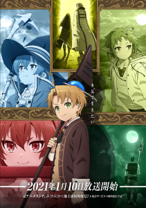
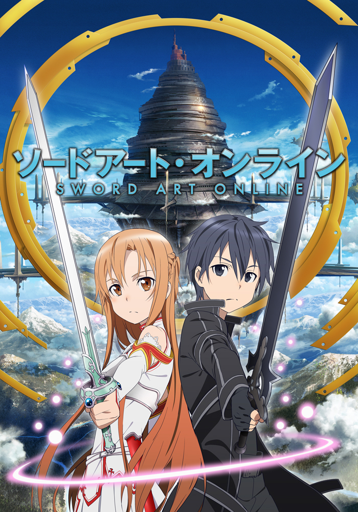
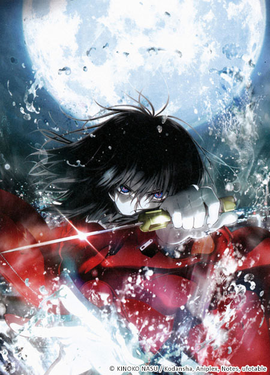
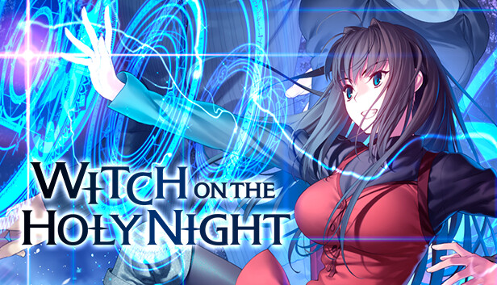
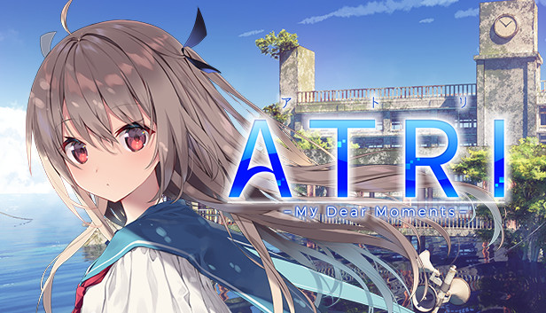
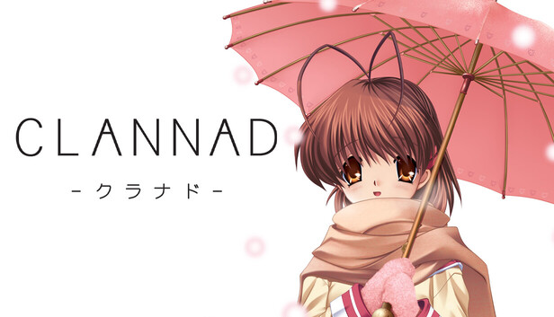

  

<h1 align="center">Kronecker</h1>

  <a href="https://blog.kronecker.cc">Blog</a> ·
  <a href="https://github.com/KiriAky107/Notes-Articles">Writing &amp; Poetry</a> ·
  <a href="https://github.com/KiriAky107?tab=repositories">Repositories</a> ·
  <a href="mailto:kiriaky_107@outlook.com">Email</a>

<blockquote>
  

    哲学家们只是用不同的方式解释世界，而问题在于改变世界。  
    The philosophers have only interpreted the world, in various ways; the point is to change it.  
    Die Philosophen haben die Welt nur verschieden interpretiert; es kommt darauf an, sie zu verändern.
  

  
— Karl Marx, <em>Theses on Feuerbach</em> (1845)

</blockquote>

## About Me

I'm Kronecker, a computer science student and a Marxist–Leninist–Maoist. I write code and poetry, arrange music for piano, and enjoy anime and visual novels.

<table>
  <tr>
    <td width="50%" valign="top">
      <h3>Theory &amp; Practice</h3>
      
Dialectical and historical materialism, political economy, and the lives and struggles of working people.

    </td>
    <td width="50%" valign="top">
      <h3>Code &amp; Systems</h3>
      
Algorithms, open source, and useful tools. I enjoy understanding how things work and building things I need.

    </td>
  </tr>
  <tr>
    <td width="50%" valign="top">
      <h3>Piano &amp; Music</h3>
      
Piano arrangements, classical music, and the soundtracks of anime and visual novels.

    </td>
    <td width="50%" valign="top">
      <h3>Poetry &amp; Writing</h3>
      
Classical Chinese poetry, essays, and reading notes—personal experience alongside reflections on history and society.

    </td>
  </tr>
</table>

## Anime & Visual Novels

### Anime

<table>
  <tr>
    <td align="center" width="33%">
       
      <a href="https://mushokutensei.jp/">Mushoku Tensei</a>
    </td>
    <td align="center" width="33%">
       
      <a href="https://www.aniplex.co.jp/lineup/swordartonline/">Sword Art Online</a>
    </td>
    <td align="center" width="33%">
       
      <a href="https://aniplexusa.com/thegardenofsinners/">The Garden of Sinners</a>
    </td>
  </tr>
</table>

Also: **Your Lie in April · Fate series · CLANNAD**

### Visual Novels

<table>
  <tr>
    <td align="center" width="33%">
       
      <a href="https://store.steampowered.com/app/2052410/WITCH_ON_THE_HOLY_NIGHT/">Witch on the Holy Night</a>
    </td>
    <td align="center" width="33%">
       
      <a href="https://store.steampowered.com/app/1230140/ATRI_My_Dear_Moments/">ATRI -My Dear Moments-</a>
    </td>
    <td align="center" width="33%">
       
      <a href="https://store.steampowered.com/app/324160/CLANNAD/">CLANNAD</a>
    </td>
  </tr>
</table>

Also: **Wonderful Everyday · 9-nine- series · STEINS;GATE · Sakura no Uta**

## Selected Work

| Repository | What you'll find |
| :--- | :--- |
| [Notes & Articles](https://github.com/KiriAky107/Notes-Articles) | Essays, philosophy reading notes, and original poetry. |
| [C++ / ACM Notes](https://github.com/KiriAky107/cpp-acm-notes-solutions) | Algorithms, problem solving, diagrams, and runnable examples. [Read online](https://kiriaky107.github.io/cpp-acm-notes-solutions/) |
| [Modern Python Notes](https://github.com/KiriAky107/python-modern-notes-examples) | Python fundamentals, software engineering, and practical examples. [Read online](https://kiriaky107.github.io/python-modern-notes-examples/) |
| [OpenNexus](https://github.com/KiriAky107/OpenNexus) | A local-first AI notebook and knowledge workspace. |

  
Tools &amp; Technologies

| Area | Tools |
| :--- | :--- |
| Languages | C++ · Python · Rust · TypeScript |
| Desktop & UI | Tauri 2 · Vue 3 · Vite · Pinia |
| Services & Data | FastAPI · Pydantic · SQLite / FTS5 / sqlite-vec · PostgreSQL |
| AI Applications | Agent · RAG · Skill · Plugin · MCP · Ollama |
| Development | Git · Linux · Docker · GitHub Actions |

## Activity

  
Statistics &amp; Languages

<table>
  <tr>
    <td width="50%" valign="top">
      <picture>
        <source media="(prefers-color-scheme: dark)" srcset="./profile/stats-dark.svg">
        
      </picture>
    </td>
    <td width="50%" valign="top">
      <picture>
        <source media="(prefers-color-scheme: dark)" srcset="./profile/top-langs-dark.svg">
        
      </picture>
    </td>
  </tr>
</table>

  
Contribution Snake

<picture>
  <source media="(prefers-color-scheme: dark)" srcset="./profile/snake-dark.svg">
  
</picture>

