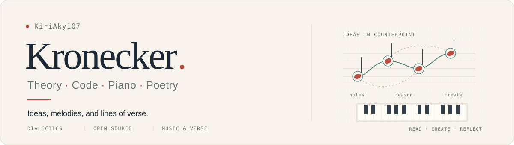

<picture>
  <source media="(prefers-color-scheme: dark)" srcset="./assets/header-dark.svg">
  
</picture>

  <a href="https://blog.kronecker.cc">Blog</a> ·
  <a href="https://github.com/KiriAky107/Notes-Articles">文字与诗词</a> ·
  <a href="https://github.com/KiriAky107?tab=repositories">Repositories</a> ·
  <a href="mailto:kiriaky_107@outlook.com">Email</a>

> 哲学家们只是用不同的方式解释世界，而问题在于改变世界。 
> ——马克思，《关于费尔巴哈的提纲》

## 你好，我是 Kronecker

计算机科学与技术专业在读。学习马列毛理论，关注现实社会与劳动者处境；写代码，也做钢琴改编、写旧体诗词。喜欢从具体的问题出发，让认识回到实践，让想法成为作品。

<table>
  <tr>
    <td width="50%" valign="top">
      <h3>01 · 理论与实践</h3>
      
<strong>Dialectical &amp; Historical Materialism</strong>

      
读理论，也关心理论怎样进入现实。关注哲学、政治经济学、社会与劳动，在阅读、讨论和实践中不断检验自己的认识。

    </td>
    <td width="50%" valign="top">
      <h3>02 · 代码与系统</h3>
      
<strong>Algorithms, Tools &amp; AI Applications</strong>

      
写算法，搭系统，做自己需要的工具。关注 Agent、RAG、桌面应用与扩展机制，也把学习过程整理成可以阅读、运行和复用的资料。

    </td>
  </tr>
  <tr>
    <td width="50%" valign="top">
      <h3>03 · 音乐与改编</h3>
      
<strong>Piano Transcription by Kronecker</strong>

      
喜欢古典钢琴与动画、视觉小说配乐。改编时关心旋律、内声、低音的关系，以及音乐与角色的联系。

      
《久远寺有珠》的尾声：a 小调 → A 大调，接入 <em>London Bridge</em>。

    </td>
    <td width="50%" valign="top">
      <h3>04 · 诗词与文字</h3>
      
<strong>Poetry, Reading &amp; Reflection</strong>

      
写旧体诗词、读书笔记和评论。文字里有个人的经历，也有对历史与现实的思考。

      
从《青玉案·晨晞》到《江城子·弱冠》。 <a href="https://github.com/KiriAky107/Notes-Articles">阅读公开文章与诗词 →</a>

    </td>
  </tr>
</table>

### 故事，也是生活的一部分

喜欢《无职转生》《刀剑神域》《魔法使之夜》《CLANNAD》，也喜欢那些能让人物、音乐与叙事彼此照应的作品。

  
Anime &amp; Visual Novels · 展开片单与收藏

**Anime** 
Mushoku Tensei · Sword Art Online · Kara no Kyoukai · Your Lie in April · Fate Series · CLANNAD

**Visual Novels** 
Mahoutsukai no Yoru · ATRI · CLANNAD · Subarashiki Hibi · 9-nine- Series · Steins;Gate · Sakura no Uta

  

## 一些作品与积累

| 作品 | 内容 |
| :--- | :--- |
| [Notes & Articles](https://github.com/KiriAky107/Notes-Articles) | 公开文章、哲学读书笔记与原创诗词。 |
| [C++ / ACM 笔记与题解](https://github.com/KiriAky107/cpp-acm-notes-solutions) | 从问题建模到算法实现，配套推演、图解与可运行代码。[在线阅读 ↗](https://kiriaky107.github.io/cpp-acm-notes-solutions/) |
| [Python 现代开发笔记](https://github.com/KiriAky107/python-modern-notes-examples) | 从语言基础到工程、Web 与 AI 应用，配套练习与完整示例。[在线阅读 ↗](https://kiriaky107.github.io/python-modern-notes-examples/) |
| [OpenNexus](https://github.com/KiriAky107/OpenNexus) | 本地优先的 AI 笔记与知识工作台，连接 Markdown、检索与可扩展工作流。 |

  
Workbench · 常用工具与技术

| 方向 | 常用工具 |
| :--- | :--- |
| 算法与编程 | C++ · Python · Rust · TypeScript |
| 桌面与交互 | Tauri 2 · Vue 3 · Vite · Pinia |
| 服务与数据 | FastAPI · Pydantic · SQLite / FTS5 / sqlite-vec · PostgreSQL |
| AI 应用 | Agent · RAG · Skill · Plugin · MCP · Ollama |
| 开发环境 | Git · Linux · Docker · GitHub Actions |

## 留下的足迹

<picture>
  
</picture>

  
GitHub in numbers · 统计与语言分布

<table>
  <tr>
    <td width="50%" valign="top">
      <picture>
        <source media="(prefers-color-scheme: dark)" srcset="./profile/stats-dark.svg">
        
      </picture>
    </td>
    <td width="50%" valign="top">
      <picture>
        <source media="(prefers-color-scheme: dark)" srcset="./profile/top-langs-dark.svg">
        
      </picture>
    </td>
  </tr>
</table>

语言分布反映公开仓库中的代码构成，不代表熟练度排名。

  
One more thing · 让贡献图动起来

<picture>
  <source media="(prefers-color-scheme: dark)" srcset="./profile/snake-dark.svg">
  
</picture>

  Theory · Code · Piano · Poetry 
  <a href="https://github.com/KiriAky107/KiriAky107/actions/workflows/profile-refresh.yml">Daily refresh</a> · <a href="./docs/AUTOMATION.md">How this profile works</a>

